# Rapport — Jours 1 à 4 : de la donnée brute Kaggle au dashboard

**Sujet :** Accidentologie routière au Royaume-Uni (2005–2017)
**Problématique :** quels facteurs (météo, luminosité, type de route, âge du conducteur, type de véhicule) aggravent la sévérité des accidents ?
**Stack :** HDFS (1 NameNode + 3 DataNodes) · Spark 4.2 · Delta Lake 4.4 · SciPy · scikit-learn · Streamlit + Plotly
**Notebooks :** `J1_HDFS_Ingestion_Bronze.ipynb`, `J2_Spark_Delta_Silver.ipynb`, `J3_Analytics_SQL_Gold.ipynb` et `J4_Stats_Segmentation_Dashboard.ipynb`
**Application :** `app/dashboard.py` (http://localhost:8501)

**Sommaire :**
- Partie 1 — Jour 1 : création de la couche Bronze (section 3)
- Partie 2 — Jour 2 : de Bronze à Silver (sections 4 à 13)
- Partie 3 — Jour 3 : analyses Spark SQL et couche Gold (sections 14 à 20)
- Partie 4 — Jour 4 : tests statistiques, segmentation et dashboard (sections 21 à 26)

---

## 1. Vue d'ensemble

Nous suivons une **architecture Médaillon** : chaque couche ajoute un niveau de qualité.

```mermaid
flowchart LR
    K["Kaggle<br/>UK Road Safety"] --> L["data_raw/archive/<br/>2 fichiers CSV"]
    L -->|"copie HDFS"| R["HDFS<br/>/lakehouse/bronze/raw/"]
    R -->|"J1 : ingestion<br/>+ traçabilité"| B["BRONZE<br/>accidents · vehicles<br/>(Delta, texte brut)"]
    B -->|"J2 : nettoyage<br/>typage · agrégation · jointure"| S["SILVER<br/>accidents_enriched<br/>(Delta, typée, enrichie)"]
    S -->|"J3 : Spark SQL<br/>agrégations · fenêtrage<br/>J4 : K-Means"| G["GOLD<br/>pareto_districts<br/>evolution_mensuelle<br/>facteurs_gravite<br/>segments_districts"]
    G -->|"J4"| D["Dashboard Streamlit<br/>:8501"]

    style B fill:#cd7f32,color:#fff
    style S fill:#c0c0c0,color:#000
    style G fill:#ffd700,color:#000
```

| Couche | Contenu | Règle |
|---|---|---|
| **Bronze** | Données **fidèles à la source**, toutes en texte | On ne modifie rien, on ajoute seulement la traçabilité |
| **Silver** | Données **nettoyées, typées, jointes et enrichies** | Une ligne = un accident, prête pour l'analyse |
| **Gold** | **Petites tables de résultats** déjà agrégées | Calculées une fois, lues instantanément par le dashboard |

---

## 2. Les données sources

Dataset Kaggle *UK Road Safety*, composé de deux fichiers liés par la clé `Accident_Index` :

| Fichier | Taille | Lignes | Contenu |
|---|---|---|---|
| `Accident_Information.csv` | 672,77 Mo | 2 047 256 | **Les faits** : un accident par ligne (date, lieu, gravité, météo, route…) |
| `Vehicle_Information.csv` | 614,57 Mo | 2 177 205 | **Les véhicules impliqués** : un véhicule par ligne (âge, type, conducteur…) |

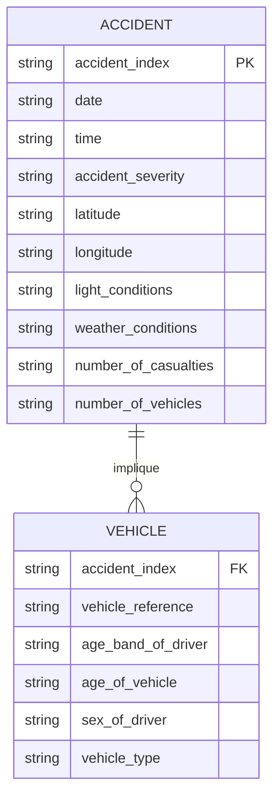

> La relation est **1-N** : un accident peut impliquer plusieurs véhicules. Ce point est central pour la jointure du Jour 2.

---

# PARTIE 1 — Jour 1 : création de la couche Bronze

## 3. Étapes du Jour 1

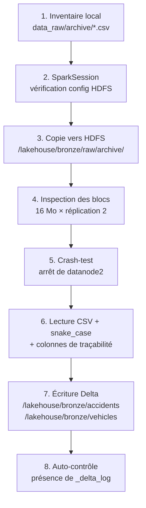

### 3.1 Inventaire et configuration du cluster

La SparkSession lit sa configuration dans `config/spark-defaults.conf`. Nous avons vérifié :

| Paramètre | Valeur | Signification |
|---|---|---|
| `fs.defaultFS` | `hdfs://namenode:9000` | Spark lit et écrit sur HDFS par défaut |
| `dfs.blocksize` | `16777216` (16 Mo) | Taille d'un bloc HDFS (volontairement petite pour le TP) |
| `dfs.replication` | `2` | Chaque bloc est stocké sur 2 DataNodes |

### 3.2 Copie sur HDFS et découpage en blocs

Les deux CSV sont copiés de `/workspace/data_raw/archive/` vers `/lakehouse/bronze/raw/archive/` avec l'API Hadoop `FileSystem.copyFromLocalFile`.

HDFS découpe chaque fichier en **blocs de 16 Mo**, et chaque bloc est **répliqué sur 2 des 3 DataNodes** :

| Fichier | Taille | Blocs |
|---|---|---|
| `Accident_Information.csv` | 672,77 Mo | **43** (42 pleins + 1 de 0,77 Mo) |
| `Vehicle_Information.csv` | 614,57 Mo | **39** (38 pleins + 1 de 6,57 Mo) |

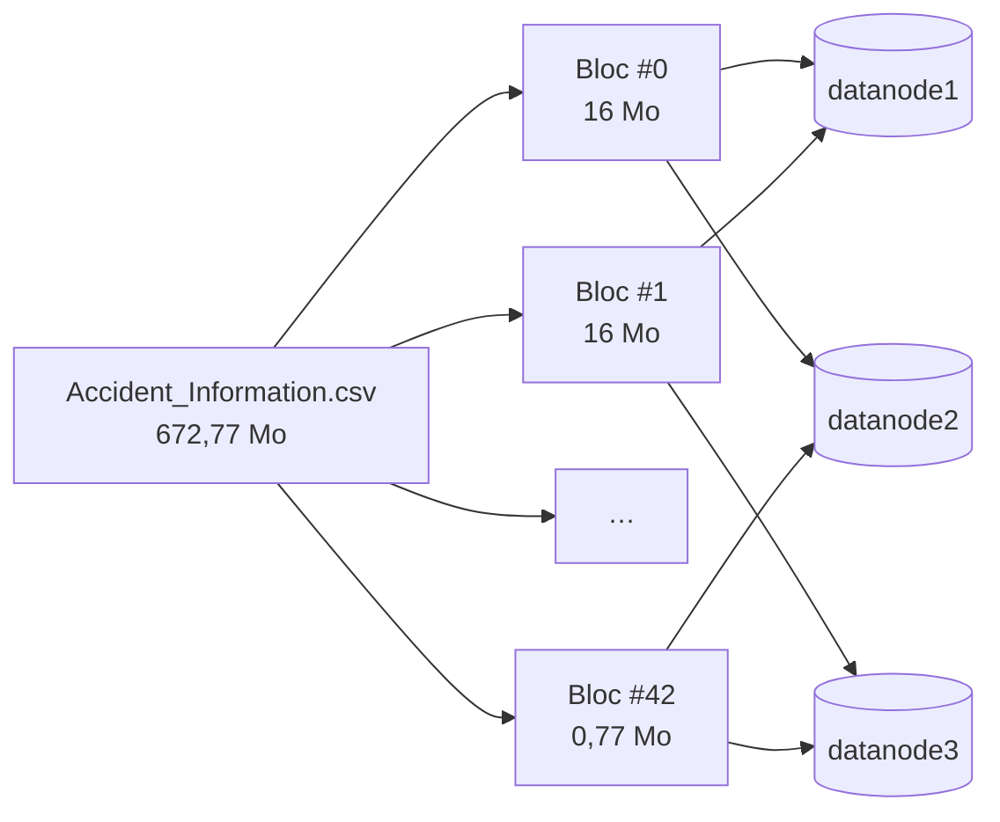

**Réponses aux questions d'analyse :**
- **Nombre de blocs** : 672,77 / 16 = 42,05, donc 42 blocs pleins et 1 dernier bloc partiel de 0,77 Mo.
- **Un fichier de 3 Mo occupe-t-il 16 Mo ?** Non. Le bloc est une **taille maximale**, pas une allocation fixe : un fichier de 3 Mo occupe 3 Mo par réplique. Il consomme en revanche une entrée dans la mémoire du NameNode, d'où le problème des « petits fichiers ».
- **Pourquoi une réplication de 2 sur 3 DataNodes ?** Pour tolérer la perte d'un nœud **et** garder un 3e nœud libre, sur lequel le NameNode peut recopier les blocs perdus afin de revenir à 2 copies.

### 3.3 Crash-test : tolérance aux pannes

Protocole : `docker stop datanode2`. Après environ **50 s** (2 × 10 s de recheck + 10 × 3 s de heartbeat), le NameNode déclare le nœud mort et **recopie automatiquement** les blocs sous-répliqués vers le DataNode restant.

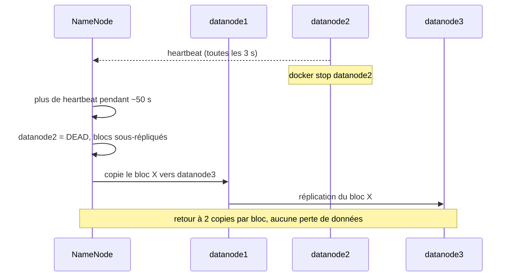

La lecture du plus gros fichier avec Spark (`df_check`) a renvoyé **2 047 257 lignes** (2 047 256 accidents + la ligne d'en-tête, puisque la lecture se faisait sans `header=True`), réparties en **10 partitions Spark**. Spark regroupe plusieurs blocs HDFS de 16 Mo par partition : il n'y a pas forcément une partition par bloc.

### 3.4 Construction des tables Bronze (Delta Lake)

Pour chaque fichier, le traitement est le suivant :

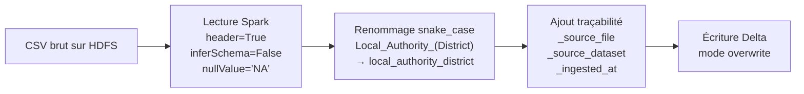

| Traitement | Code | Justification |
|---|---|---|
| Lecture avec en-tête | `option("header", True)` | Les noms de colonnes viennent de la 1re ligne |
| **Pas d'inférence de type** | `option("inferSchema", False)` | Bronze reste **fidèle à la source** : tout en texte, le typage est fait en Silver |
| NULL explicites | `option("nullValue", "NA")` | Les `"NA"` du CSV deviennent de vrais NULL |
| Noms normalisés | fonction `to_snake()` (expression régulière) | Delta et Parquet refusent les espaces et parenthèses dans les noms de colonnes |
| `_source_file` | `F.col("_metadata.file_path")` | Fichier d'origine de chaque ligne |
| `_source_dataset` | `F.lit("uk_road_safety")` | Dataset d'origine |
| `_ingested_at` | `F.current_timestamp()` | Date et heure d'ingestion |

**Résultat du Jour 1 :**

| Table Bronze | Chemin HDFS | Lignes |
|---|---|---|
| `accidents` | `/lakehouse/bronze/accidents` | 2 047 256 |
| `vehicles` | `/lakehouse/bronze/vehicles` | 2 177 205 |

L'auto-contrôle final vérifie que chaque dossier contient bien un `_delta_log`, c'est-à-dire qu'il s'agit de vraies tables Delta.

---

# PARTIE 2 — Jour 2 : de Bronze à Silver

## 4. Vue d'ensemble du pipeline Silver

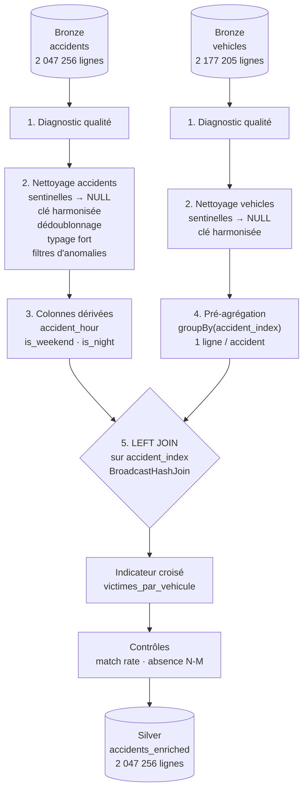

## 5. Étape 1 — Diagnostic qualité (exercice 1.1)

Avant toute modification, nous avons mesuré l'état des tables Bronze.

**Valeurs NULL (table accidents) — principales colonnes concernées :**

| Colonne | NULL | % |
|---|---|---|
| `2nd_road_class` | 844 272 | 41,24 % |
| `2nd_road_number` | 17 593 | 0,86 % |
| `pedestrian_crossing_physical_facilities` | 3 560 | 0,17 % |
| `latitude` / `longitude` | 174 / 175 | 0,01 % |
| `speed_limit` | 37 | ~0 % |
| `accident_index` (clé) | **0** | 0 % |

> Le fort taux de `2nd_road_class` est normal : un accident hors intersection n'a pas de deuxième route.

**Doublons et unicité de la clé :**

| Table | Lignes | Doublons complets | Clé NULL | Clés distinctes | Ratio lignes/clé |
|---|---|---|---|---|---|
| accidents | 2 047 256 | 0 | 0 | 2 047 256 | **1,00** |
| vehicles | 2 177 205 | 0 | 0 | 1 488 981 | **1,46** |

Le **ratio lignes/clé** (nombre de lignes / nombre de clés distinctes) indique combien de fois chaque clé apparaît en moyenne :
- **1,00** pour accidents : la clé est unique.
- **1,46** pour vehicles : environ 1,5 véhicule par accident. **Sans pré-agrégation, la jointure dupliquerait les accidents.**

## 6. Étape 2 — Nettoyage de la table accidents

| Traitement | Code | Effet |
|---|---|---|
| Valeurs sentinelles → NULL | `null_sentinels()` | `"Data missing or out of range"` devient un vrai NULL |
| Harmonisation de la clé | `F.upper(F.trim(accident_index))` | Même format des deux côtés de la jointure |
| Clés nulles retirées | `filter(isNotNull)` | 0 ligne retirée |
| Dédoublonnage | `dropDuplicates(["accident_index"])` | 0 ligne retirée |
| Date | `F.try_to_date("date", "yyyy-MM-dd")` | texte → `date` |
| Horodatage | `F.try_to_timestamp(concat_ws(" ", date, time), F.lit("yyyy-MM-dd HH:mm"))` | texte → `timestamp` |
| Coordonnées | `try_cast("double")` | `latitude`, `longitude` |
| Compteurs | `try_cast("int")` | `number_of_casualties`, `number_of_vehicles`, `speed_limit`, `year` |
| Filtres d'anomalies | date non nulle, `number_of_vehicles > 0`, latitude entre 49 et 61 (ou NULL) | 0 ligne retirée |
| Colonnes brutes retirées | `drop("date", "time")` | Remplacées par leurs versions typées |

**Pourquoi les fonctions `try_*` ?** Spark 4 active le **mode ANSI** : une conversion impossible (par exemple une heure vide qui donne `"2005-11-30 "`) **fait planter le job**. Les fonctions `try_to_date`, `try_to_timestamp` et `try_cast` renvoient NULL à la place.

> Nous avons rencontré ce cas : l'erreur n'est apparue qu'au moment de l'écriture (`save()`), et pas au `count()`. C'est une illustration de la **Lazy Evaluation** : le `count()` n'avait pas besoin de la colonne `accident_ts`, donc Spark ne l'avait pas calculée.

## 7. Étape 3 — Colonnes métier dérivées

| Colonne | Source | Calcul | Usage prévu (J3/J4) |
|---|---|---|---|
| `accident_hour` | accidents | `F.hour(accident_ts)` | Répartition horaire des accidents |
| `is_weekend` | accidents | jour de la semaine ∈ {samedi, dimanche} | Comparaison semaine / week-end |
| `is_night` | accidents | `light_conditions` commence par « Darkness » | Effet de la luminosité sur la gravité |

## 8. Étape 4 — Pré-agrégation de la table vehicles

Pour éviter l'**explosion N-à-M**, la table vehicles est résumée à **une ligne par accident** avant la jointure.

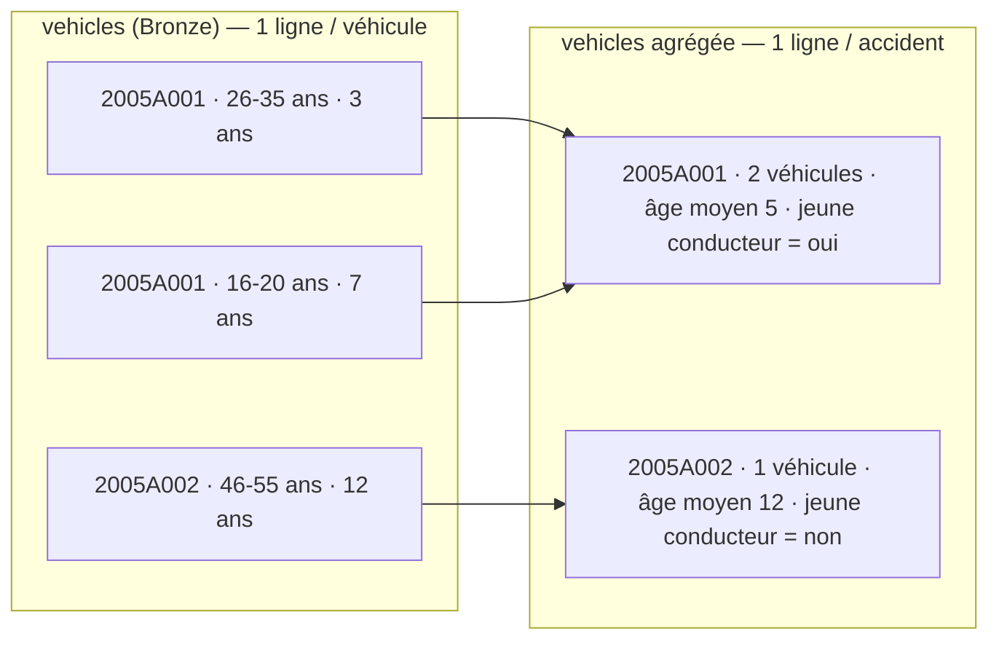

| Colonne agrégée | Calcul |
|---|---|
| `nb_vehicules_enregistres` | `F.count("*")` |
| `age_moyen_vehicules` | `F.round(F.avg("age_of_vehicle"), 1)` |
| `has_young_driver` | au moins un conducteur dans la tranche `16 - 20` ou `21 - 25` |

## 9. Étape 5 — Jointure, indicateur croisé et contrôles

### 9.1 Pourquoi la pré-agrégation est indispensable

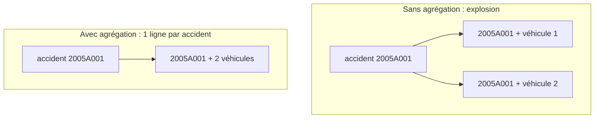

### 9.2 Stratégie physique choisie par Spark

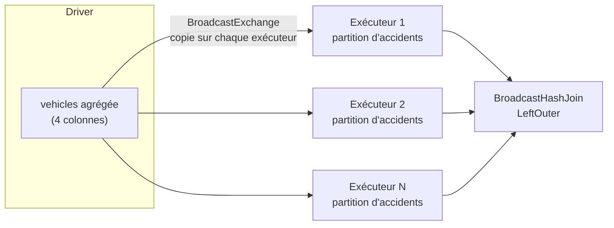

Le plan physique (`.explain("simple")`) montre un **`BroadcastHashJoin` LeftOuter**, choisi **automatiquement** par Spark : la table vehicles agrégée ne compte que 4 colonnes, elle est donc assez compacte pour être copiée sur chaque exécuteur. La grande table accidents n'a pas besoin d'être redistribuée pour la jointure.

Les deux `Exchange hashpartitioning` visibles dans le plan sont des **Shuffles** (transformations *Wide*), mais ils proviennent du `dropDuplicates` (côté accidents) et du `groupBy` (côté vehicles), pas de la jointure.

### 9.3 Indicateur croisant les deux sources

`victimes_par_vehicule = number_of_casualties / nb_vehicules_enregistres`

Il combine une donnée de la table accidents et une donnée de la table vehicles.

### 9.4 Contrôles de qualité de la jointure

| Contrôle | Résultat | Verdict |
|---|---|---|
| Lignes avant jointure | 2 047 256 | |
| Lignes dans la table Silver | 2 047 256 | ✅ aucune explosion N-M (`assert` validé) |
| Accidents rapprochés d'au moins un véhicule | 1 389 724 | |
| **Match rate** | **67,88 %** | ⚠️ à expliquer |

**Interprétation du match rate :** environ 32 % des accidents n'ont aucun véhicule correspondant. Ce n'est pas une erreur de code : les deux fichiers Kaggle **ne couvrent pas exactement les mêmes accidents** (le fichier vehicles commence par exemple en 2004, le fichier accidents en 2005). Pour ces accidents, les colonnes issues de vehicles valent NULL. Nous les conservons grâce au `LEFT JOIN` : leurs autres informations (gravité, lieu, météo) restent exploitables.

## 10. Étape 6 — Écriture de la table Silver

```python
df_silver.write.format("delta") \
    .mode("overwrite") \
    .option("overwriteSchema", "true") \
    .save("/lakehouse/silver/accidents_enriched")
```

**Schéma de la table Silver (colonnes ajoutées ou transformées) :**

| Colonne | Type | Origine |
|---|---|---|
| `accident_index` | string | clé harmonisée |
| `accident_date` | date | `date` typée |
| `accident_ts` | timestamp | `date` + `time` |
| `accident_hour` | int | dérivée |
| `is_weekend` | boolean | dérivée |
| `is_night` | boolean | dérivée |
| `latitude`, `longitude` | double | typées |
| `number_of_casualties`, `number_of_vehicles`, `speed_limit`, `year` | int | typées |
| `nb_vehicules_enregistres` | bigint | agrégée depuis vehicles |
| `age_moyen_vehicules` | double | agrégée depuis vehicles |
| `has_young_driver` | boolean | agrégée depuis vehicles |
| `victimes_par_vehicule` | double | **indicateur croisé** |
| autres colonnes accidents | string | conservées telles quelles (sentinelles → NULL) |

## 11. Garanties ACID de Delta Lake (exercices 3.1 et 3.2)

### 11.1 Le journal de transactions `_delta_log`

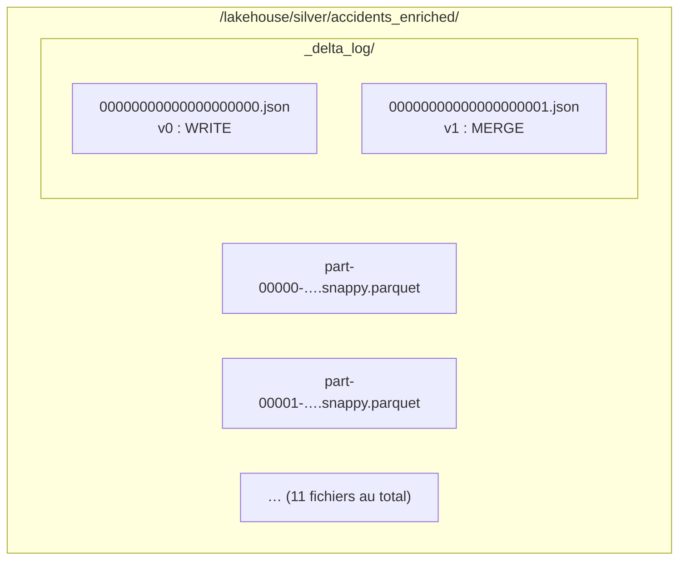

Le fichier `00000000000000000000.json` contient une action par ligne :

| Action | Contenu |
|---|---|
| `commitInfo` | Opération `WRITE`, mode `Overwrite`, horodatage, statistiques |
| `metaData` | **Schéma de la table** (noms et types des colonnes) |
| `protocol` | Version du protocole Delta (`minReaderVersion 1`, `minWriterVersion 2`) |
| `add` | Un fichier Parquet ajouté à la table (11 fichiers) |

Tant que ce fichier JSON n'est pas écrit, les nouveaux fichiers Parquet sont ignorés : c'est ce qui garantit l'**atomicité**. Nos écritures qui ont échoué au cours du TP n'ont donc laissé aucune trace dans la table.

### 11.2 Schema Enforcement

Un DataFrame avec des colonnes inconnues (`fake_id`, `intruder_col`) a été ajouté en mode `append` :

```
[DELTA_METADATA_MISMATCH] A metadata mismatch was detected when writing to the Delta table.
```

✅ Delta a **refusé l'écriture** : la table est protégée contre les données incohérentes.

### 11.3 MERGE INTO (upsert) et Time Travel

Lot de test : **5 accidents existants corrigés** (+1 victime) et **1 nouvel accident** (`TEST_NEW_001`).

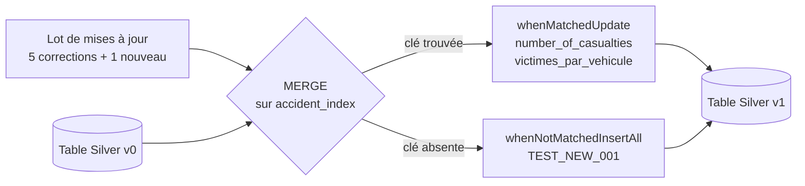

| `accident_index` | Victimes v0 | Victimes v1 |
|---|---|---|
| 200501BS00014 | 1 | 2 |
| 200501BS70006 | 2 | 3 |
| 200501BS70011 | 1 | 2 |
| 200501BS70042 | 2 | 3 |
| 200501BS70073 | 1 | 2 |
| TEST_NEW_001 | *(absent)* | 1 |

**Historique (`DESCRIBE HISTORY`) :**

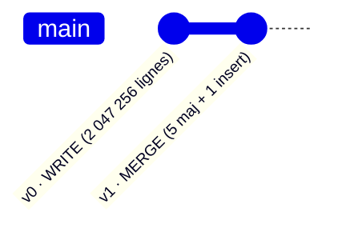

- `option("versionAsOf", 0)` relit la table **avant** le MERGE : c'est le **Time Travel**.
- `numTargetRowsCopied = 204 565` : pour modifier 5 lignes, Delta a réécrit le fichier Parquet qui les contenait (**copy-on-write**). Les anciens fichiers sont conservés, ce qui rend le Time Travel possible.

> **Nettoyage avant le Jour 3 :** les données de test doivent être annulées avec `DeltaTable.forPath(spark, SILVER_MAIN_PATH).restoreToVersion(0)`, qui crée une nouvelle version `RESTORE` dans l'historique. Au Jour 3, la table Silver compte bien **2 047 256 lignes** : la ligne fictive `TEST_NEW_001` n'y est plus.

---

## 12. Choix volontaires sur les valeurs manquantes

| Option | Choix | Raison |
|---|---|---|
| Supprimer les lignes avec des NULL (`dropna`) | ❌ Non | On perdrait par exemple 41 % des accidents à cause de `2nd_road_class` seule |
| Remplacer les NULL par 0 ou par une moyenne | ❌ Non | `nb_vehicules_enregistres = NULL` signifie « inconnu », pas « zéro » ; cela fausserait les statistiques |
| Conserver les NULL et filtrer selon l'analyse | ✅ Oui | Chaque analyse du Jour 3/4 filtrera selon son besoin |
| Supprimer les lignes **inutilisables** (clé ou date absente) | ✅ Oui | 0 ligne concernée dans nos données |

---

## 13. Synthèse Bronze → Silver

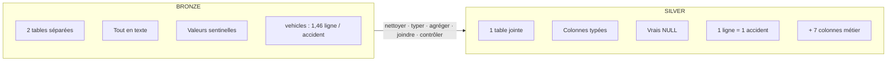

| | Bronze | Silver |
|---|---|---|
| Nombre de tables | 2 (accidents, vehicles) | 1 (`accidents_enriched`) |
| Types | tout en `string` | `date`, `timestamp`, `int`, `double`, `boolean` |
| Valeurs manquantes | `"NA"` et `"Data missing or out of range"` | vrais `NULL` |
| Granularité | 1 accident / 1 véhicule par ligne | **1 accident par ligne** |
| Lignes | 2 047 256 + 2 177 205 | **2 047 256** |
| Nouvelles colonnes | traçabilité (`_source_*`, `_ingested_at`) | `accident_hour`, `is_weekend`, `is_night`, `nb_vehicules_enregistres`, `age_moyen_vehicules`, `has_young_driver`, `victimes_par_vehicule` |
| Garanties | Delta (versionnée) | Delta + Schema Enforcement, MERGE et Time Travel démontrés |

**En une phrase :** nous sommes passés de **deux fichiers CSV bruts** stockés et répliqués sur HDFS à **une table Delta unique, propre, typée et enrichie**, avec une ligne par accident, contrôlée contre les doublons et prête pour les analyses des Jours 3 et 4.

---

# PARTIE 3 — Jour 3 : analyses Spark SQL et couche Gold

## 14. Vue d'ensemble du Jour 3

Au Jour 3, nous **analysons** la table Silver avec **Spark SQL** et nous produisons **3 tables Gold** : de petites tables de résultats, déjà calculées, qui alimenteront le dashboard du Jour 4.

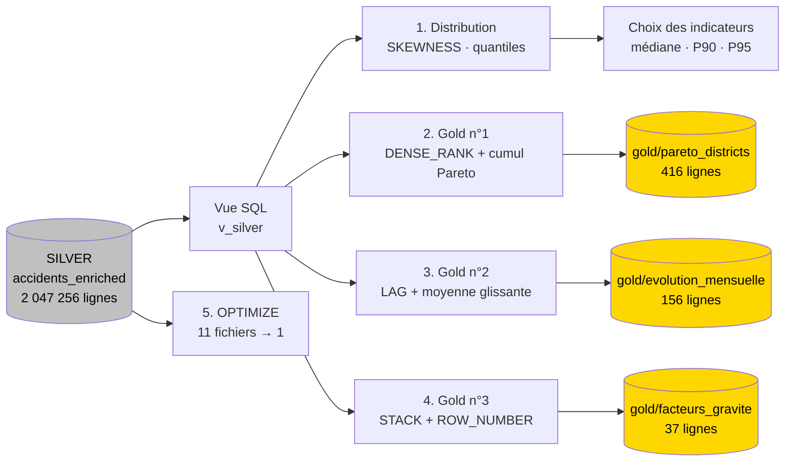

**Pourquoi une couche Gold ?** Un dashboard ne doit pas recalculer 2 millions de lignes à chaque clic. On calcule **une fois** et on stocke quelques centaines de lignes de résultats.

**Préparation :** la table Silver est enregistrée comme vue SQL temporaire, ce qui permet d'écrire `FROM v_silver` dans toutes les requêtes :

```python
SILVER_MAIN_PATH = "/lakehouse/silver/accidents_enriched"
spark.read.format("delta").load(SILVER_MAIN_PATH).createOrReplaceTempView("v_silver")
```

## 15. Étape 1 — Distribution du nombre de victimes (exercice 1.1)

### 15.1 La question

Pour résumer « combien de victimes fait un accident », vaut-il mieux utiliser la **moyenne** ou la **médiane** ? Tout dépend de l'**asymétrie** de la variable : quand quelques valeurs extrêmes existent, elles tirent la moyenne vers le haut.

### 15.2 La requête

```sql
SELECT COUNT(*), AVG(number_of_casualties), STDDEV(number_of_casualties),
       SKEWNESS(number_of_casualties),
       PERCENTILE_APPROX(number_of_casualties, 0.25),  -- P25
       PERCENTILE_APPROX(number_of_casualties, 0.50),  -- médiane
       PERCENTILE_APPROX(number_of_casualties, 0.75),  -- P75
       PERCENTILE_APPROX(number_of_casualties, 0.90),  -- P90
       PERCENTILE_APPROX(number_of_casualties, 0.95),  -- P95
       MAX(number_of_casualties)
FROM v_silver
```

`PERCENTILE_APPROX` calcule des quantiles **approchés**, donc rapides : un calcul exact obligerait Spark à trier 2 millions de lignes.

### 15.3 Résultats

| Accidents | Moyenne | Écart-type | **Skewness** | P25 | **Médiane** | P75 | IQR | P90 | P95 | Max |
|---|---|---|---|---|---|---|---|---|---|---|
| 2 047 256 | 1,346 | 0,818 | **8,573** | 1 | **1** | 1 | 0 | 2 | 3 | 93 |

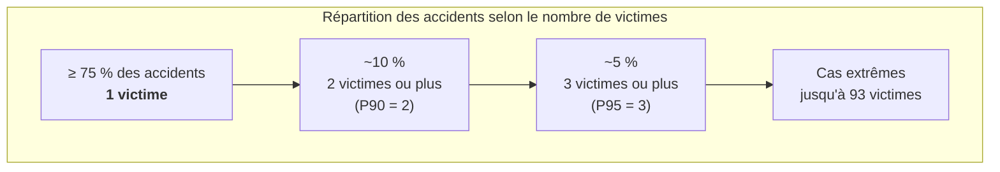

### 15.4 Interprétation

- La plupart des accidents ne font **qu'une seule victime** : P25, médiane et P75 valent tous **1**.
- Quelques accidents rares font beaucoup de victimes (jusqu'à **93**). Ils **tirent la moyenne à 1,35**, alors qu'aucun accident réel n'a 1,35 victime.
- La **skewness de 8,57** (très supérieure à 1) confirme une distribution **très asymétrique**, avec une longue traîne à droite.

**Choix des indicateurs :**

| Indicateur | Retenu ? | Raison |
|---|---|---|
| Moyenne | Seulement pour des totaux | Gonflée par les cas extrêmes |
| **Médiane** | ✅ Oui | Représente un accident typique |
| IQR | ❌ Peu utile | Vaut 0 : ne permet pas de comparer des groupes |
| **P90 / P95** | ✅ Oui | Suivent les accidents lourds |
| **% d'accidents graves ou mortels** | ✅ Oui | Plus discriminant que la médiane pour comparer des catégories |

## 16. Étape 2 — Gold n°1 : classement des districts et loi de Pareto (exercice 2.1)

### 16.1 Les notions

- **Classement métier** : on regroupe les accidents par **district** (`local_authority_district`) et on classe les districts du plus touché au moins touché.
- **Loi de Pareto (80/20)** : dans beaucoup de situations, **20 % des catégories concentrent 80 % du total**. La question devient : *un petit nombre de districts concentre-t-il la majorité des victimes ?*

### 16.2 La requête (structure en CTE)

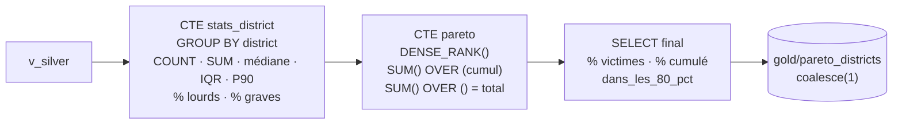

Les fonctions clés :

| Fonction | Rôle |
|---|---|
| `DENSE_RANK() OVER (ORDER BY total_victimes DESC)` | Rang du district |
| `SUM(total_victimes) OVER (ORDER BY total_victimes DESC ROWS BETWEEN UNBOUNDED PRECEDING AND CURRENT ROW)` | **Somme cumulée** du 1er district jusqu'à la ligne courante |
| `SUM(total_victimes) OVER ()` | **Total général** (toutes les lignes) |
| `(cumul − total du district) < 0,8 × total général` | Le district fait-il partie de ceux qui forment les 80 % ? |

Les **fonctions de fenêtrage** (`OVER`) calculent une valeur en regardant les autres lignes (rang, cumul), **sans les fusionner**, contrairement à `GROUP BY`.

### 16.3 Résultats (15 premiers districts)

| Rang | District | Accidents | Victimes | % victimes | **% cumulé** | % accidents lourds | % graves |
|---|---|---|---|---|---|---|---|
| 1 | Birmingham | 39 662 | 54 415 | 1,97 | 1,97 | 24,25 | 13,27 |
| 2 | Leeds | 27 334 | 37 779 | 1,37 | 3,35 | 24,88 | 14,48 |
| 3 | Bradford | 18 147 | 26 519 | 0,96 | 4,31 | 28,01 | 14,42 |
| 4 | Liverpool | 17 281 | 25 763 | 0,94 | 5,24 | 28,67 | 15,84 |
| 5 | Manchester | 18 113 | 25 010 | 0,91 | 6,15 | 23,63 | 12,69 |
| 6 | Sheffield | 17 321 | 23 691 | 0,86 | 7,01 | 23,90 | 14,75 |
| 7 | Glasgow City | 18 555 | 23 136 | 0,84 | 7,85 | 17,60 | 14,65 |
| 8 | Westminster | 19 774 | 22 530 | 0,82 | 8,67 | 10,46 | 13,73 |
| 9 | Kirklees | 13 439 | 19 637 | 0,71 | 9,38 | 28,66 | 14,80 |
| 10 | Edinburgh, City of | 15 774 | 18 717 | 0,68 | 10,06 | 13,18 | 13,40 |
| 11 | Bristol, City of | 14 672 | 17 788 | 0,65 | 10,71 | 15,38 | 11,40 |
| 12 | Doncaster | 12 092 | 17 511 | 0,64 | 11,34 | 28,55 | 13,70 |
| 13 | Barnet | 13 799 | 17 290 | 0,63 | 11,97 | 18,12 | 11,32 |
| 14 | Lambeth | 14 943 | 17 139 | 0,62 | 12,59 | 10,93 | 12,92 |
| 15 | Cornwall | 11 467 | 16 582 | 0,60 | 13,19 | 28,82 | 15,85 |

> **Résultat clé : 241 districts sur 416 (57,9 %) concentrent 80 % des victimes.**

### 16.4 Interprétation

```
Pareto « classique » : 20 % des districts → 80 % des victimes   (concentré)
Nos données          : 58 % des districts → 80 % des victimes   (réparti)
Répartition égale    : 80 % des districts → 80 % des victimes   (parfaitement égal)
```

- **La loi de Pareto ne s'applique pas ici.** Le district le plus touché (Birmingham) ne pèse que **2 %** des victimes, et les 15 premiers seulement **13 %**.
- Les victimes sont **réparties sur tout le territoire** : elles suivent surtout la **population et le trafic** de chaque district.
- **Conséquence métier :** cibler quelques districts serait peu efficace. Il est plus pertinent d'agir sur les **facteurs de risque** (section 18).
- **Observation complémentaire :** les districts du centre de Londres (Westminster 10,5 %, Lambeth 10,9 %) ont **peu d'accidents lourds**, alors que les districts plus ruraux (Cornwall 28,8 %, Doncaster 28,6 %) en ont presque **trois fois plus**. Ce constat annonce le rôle de la zone rurale mis en évidence en section 18.

## 17. Étape 3 — Gold n°2 : évolution dans le temps (exercice 3.1)

### 17.1 Les notions

- **`LAG(valeur, n)`** récupère la valeur de la ligne située **n lignes avant**. On peut ainsi comparer une période avec la précédente.
- **Piège de la saisonnalité :** comparer un mois au mois précédent donne des variations très bruitées (il y a toujours plus d'accidents en novembre qu'en août). On compare donc aussi au **même mois de l'année précédente** avec `LAG(..., 12)`.
- **Moyenne glissante sur 12 mois** : la moyenne des 12 derniers mois donne une courbe lisse qui montre la **vraie tendance**.

| mois | nb_accidents | `LAG(nb_accidents, 1)` | évolution |
|---|---|---|---|
| 2005-01 | 15 000 | NULL | — |
| 2005-02 | 14 000 | 15 000 | −6,7 % |

*(exemple illustratif)*

### 17.2 La requête

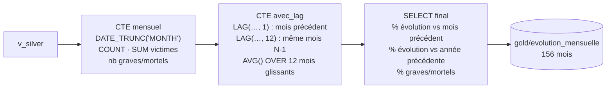

### 17.3 Résultats

**Période :** janvier 2005 à décembre 2017, soit **156 mois complets** (aucune année partielle).

| Année | Accidents | Victimes | % graves ou mortels |
|---|---|---|---|
| 2005 | 198 735 | 271 017 | 14,06 |
| 2006 | 189 161 | 258 404 | 14,73 |
| 2007 | 182 115 | 247 780 | 14,85 |
| 2008 | 170 591 | 230 905 | 14,93 |
| 2009 | 163 554 | 222 146 | 14,71 |
| 2010 | 154 414 | 208 648 | 14,36 |
| 2011 | 151 474 | 203 950 | 15,04 |
| 2012 | 145 571 | 195 723 | 15,48 |
| 2013 | 138 660 | 183 670 | 15,31 |
| 2014 | 146 322 | 194 477 | 15,26 |
| 2015 | 140 056 | 186 189 | 15,46 |
| 2016 | 136 621 | 181 384 | 17,14 |
| 2017 | 129 982 | 170 993 | 18,63 |

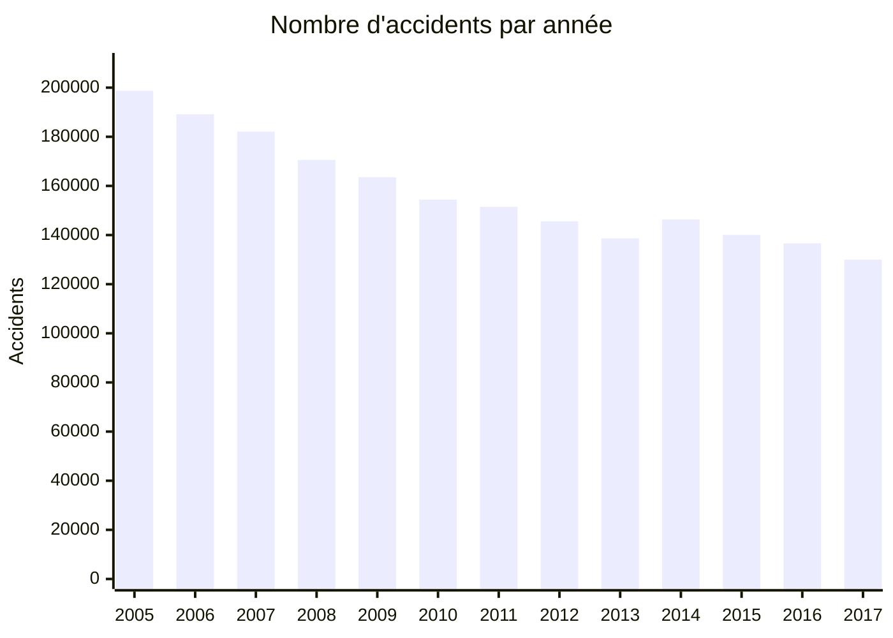

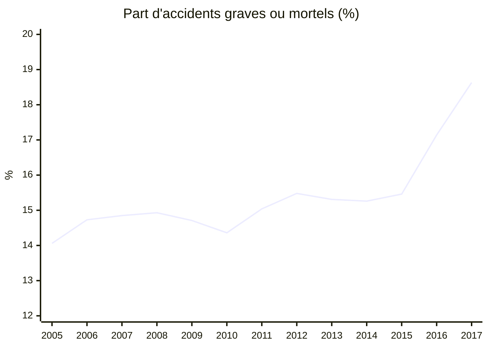

**Moyenne glissante sur 12 mois :** de **16 441 accidents/mois** (janvier 2006) à **10 832** (décembre 2017), soit **−34,1 %**.

**Saisonnalité (moyenne par mois calendaire, 2005–2017) :**

| Mois | Accidents (moyenne) | % graves |
|---|---|---|
| Novembre | 14 422 | 14,87 |
| Octobre | 14 154 | 15,35 |
| Juillet | 13 835 | 15,95 |
| Septembre | 13 540 | 15,93 |
| Juin | 13 335 | 15,86 |
| Mai | 13 307 | 15,83 |
| Août | 12 890 | **16,27** |
| Décembre | 12 883 | 14,85 |
| Janvier | 12 693 | 14,49 |
| Mars | 12 625 | 14,89 |
| Avril | 12 101 | 15,64 |
| Février | 11 697 | 14,49 |

### 17.4 Interprétation

- **Les accidents baissent :** de 198 735 en 2005 à 129 982 en 2017, soit **un tiers de moins (−35 %)**. La baisse est régulière, sauf en 2014 (+5,5 %).
- **Mais ils sont plus graves :** la part d'accidents graves ou mortels passe de **14 % à 19 %**, avec un saut en 2016–2017. Ce sont surtout les **petits accidents** qui ont diminué. Le saut de 2016 pourrait aussi venir d'un changement dans la façon dont la police enregistre la gravité : c'est une hypothèse, non vérifiée ici.
- **Les saisons comptent :** il y a **plus d'accidents en octobre et novembre** (nuits plus longues, pluie) et **des accidents plus graves en été** (juillet, août). Février est le mois le plus calme, mais il n'a que 28 jours : ramené au nombre de jours, il est proche de janvier.

## 18. Étape 4 — Gold n°3 : les facteurs qui aggravent les accidents (exercice 4.1)

### 18.1 Pourquoi cette table

C'est la table qui **répond directement à la problématique**. La Gold n°1 a montré que le **lieu** explique peu de choses, et la Gold n°2 a montré **quand** il y a des accidents. Il reste à savoir **quels facteurs rendent un accident plus grave**.

### 18.2 La méthode

```mermaid
flowchart TD
    V["v_silver<br/>1 ligne = 1 accident"] --> S["STACK(8, …)<br/>8 facteurs empilés<br/>→ colonnes facteur / modalite"]
    S --> A["GROUP BY facteur, modalite<br/>% graves/mortels · % mortels<br/>HAVING COUNT(*) ≥ 1000"]
    A --> R["ROW_NUMBER() OVER<br/>(PARTITION BY facteur<br/>ORDER BY % graves DESC)"]
    T["Taux global<br/>15,3 % graves/mortels"] --> RR["risque_relatif =<br/>% modalité / % global"]
    R --> RR
    RR --> G[("gold/facteurs_gravite")]
```

| Élément | Rôle |
|---|---|
| `STACK(8, …)` | Transforme 8 colonnes de facteurs en 2 colonnes (`facteur`, `modalite`), pour tout analyser avec **une seule requête** |
| `AVG(est_grave) * 100` | % d'accidents graves ou mortels (la moyenne d'une colonne de 0 et de 1 est une proportion) |
| `HAVING COUNT(*) >= 1000` | Écarte les modalités trop rares, dont le taux ne serait pas fiable |
| `ROW_NUMBER() OVER (PARTITION BY facteur …)` | Classement **séparé pour chaque facteur** : rang 1 = modalité la plus grave du facteur |
| `risque_relatif` | 1,0 = risque moyen ; 1,5 = 50 % d'accidents graves en plus que la moyenne |

**Facteurs analysés :** luminosité, météo, type de route, état de la route, limite de vitesse, zone (urbaine ou rurale), week-end, jeune conducteur.

```mermaid
flowchart LR
    subgraph P["PARTITION BY facteur : un classement par facteur"]
        direction TB
        subgraph L["Luminosité"]
            L1["1. Darkness - no lighting"]
            L2["2. Darkness - lights unlit"]
            L3["…"]
        end
        subgraph Vi["Limite de vitesse"]
            V1["1. 60 mph"]
            V2["2. 50 mph"]
            V3["…"]
        end
    end
```

### 18.3 Résultats : la modalité la plus aggravante de chaque facteur

| Facteur | Modalité la plus grave | Accidents | % graves/mortels | % mortels | **Risque relatif** |
|---|---|---|---|---|---|
| Luminosité | Darkness - no lighting | 112 644 | 24,27 | 4,39 | **1,59** |
| Limite de vitesse | 60 mph | 317 469 | 22,46 | 3,15 | **1,47** |
| Zone | Rural | 724 757 | 18,85 | 2,35 | **1,23** |
| Week-end | Oui | 498 479 | 17,66 | 1,75 | 1,16 |
| Météo | Fine + high winds | 25 816 | 17,07 | 1,86 | 1,12 |
| Type de route | Single carriageway | 1 527 882 | 16,17 | 1,31 | 1,06 |
| État de la route | Flood over 3cm deep | 2 845 | 15,89 | 2,04 | 1,04 |
| Jeune conducteur | Non | 961 160 | 15,17 | 1,39 | 0,99 |

```mermaid
xychart-beta
    title "Risque relatif d'accident grave (1,0 = moyenne)"
    x-axis ["Nuit sans éclairage", "60 mph", "Rural", "Week-end", "Vent fort", "Route simple", "Route inondée", "Jeune cond."]
    y-axis "Risque relatif" 0 --> 1.8
    bar [1.59, 1.47, 1.23, 1.16, 1.12, 1.06, 1.04, 0.95]
```

**Détails marquants :**

| Facteur | Comparaison | Lecture |
|---|---|---|
| Luminosité | Nuit sans éclairage : **4,39 %** de mortels / Jour : **1,03 %** | **4 fois plus** d'accidents mortels |
| Zone | Rural : 18,85 % graves / Urbain : 13,31 % | La campagne est nettement plus grave |
| Vitesse | 60 mph : 22,46 % / 30 mph : 13,44 % | Plus la route est rapide, plus c'est grave (sauf 70 mph : autoroutes et voies séparées) |
| Météo | Neige : risque 0,71 / Pluie : 0,89 | La mauvaise météo rend les accidents **moins** graves |
| État de la route | Neige : 0,71 / Verglas : 0,86 | Même constat |
| Type de route | Rond-point : **0,63** | Endroit le moins grave |
| Jeune conducteur | Oui : 0,95 / Non : 0,99 | Pas d'effet aggravant |

### 18.4 Interprétation

En moyenne, **15 %** des accidents sont graves ou mortels.

**Les facteurs les plus aggravants :**
- **La nuit sans éclairage** : 24 % d'accidents graves, et **4 fois plus d'accidents mortels** qu'en plein jour.
- **Les routes limitées à 60 mph** : 22 % d'accidents graves. On y roule vite, sur des routes simples.
- **La campagne** : 19 % d'accidents graves, contre 13 % en ville.
- **Le week-end** : un peu plus grave qu'en semaine.

**Surprises :**
- La **pluie**, la **neige** et le **verglas** rendent les accidents **moins graves**, probablement parce que les conducteurs **ralentissent**.
- Les **ronds-points** sont les endroits les moins graves (vitesse faible).
- Les **jeunes conducteurs** n'ont pas d'accidents plus graves que les autres. Le rang 1 de la modalité « Non » ne signifie pas « aggravant » : son risque (0,99) est dans la moyenne.

**Conclusion :** ce qui rend un accident grave, c'est surtout **la vitesse et le manque de visibilité** (routes de campagne rapides, la nuit, sans éclairage), et non la mauvaise météo.

**Limites :**
- Ces facteurs sont **liés entre eux** : une route de campagne est souvent rapide et non éclairée. Ce sont des **corrélations**, pas des causes prouvées.
- « Flood over 3cm » repose sur seulement 2 845 accidents, avec un risque proche de la moyenne : ce n'est pas significatif.
- « Jeune conducteur » n'est connu que pour les accidents rapprochés d'un véhicule au Jour 2 (match rate de 68 %).

La première limite est traitée dans la section suivante.

### 18.5 Vérification : la nuit aggrave-t-elle les accidents à vitesse égale ?

**La question.** Les routes non éclairées sont souvent des routes rapides de campagne. La nuit sans éclairage est-elle grave **par elle-même**, ou seulement parce que l'on y roule vite ?

**La méthode.** On croise **deux facteurs** dans une heatmap (graphique 5 du notebook J3) : la luminosité en lignes, la limite de vitesse en colonnes, et dans chaque case le **% d'accidents graves ou mortels**. Dans une **même colonne**, la vitesse est la même et seule la luminosité change : on compare donc **à vitesse égale**.

```sql
SELECT light_conditions, speed_limit,
       COUNT(*) AS nb_accidents,
       ROUND(AVG(CASE WHEN accident_severity IN ('Serious','Fatal') THEN 1 ELSE 0 END) * 100, 1)
           AS pct_graves_mortels
FROM v_silver
WHERE light_conditions IN ('Daylight', 'Darkness - lights lit', 'Darkness - no lighting')
  AND speed_limit IN (20, 30, 40, 50, 60, 70)
GROUP BY light_conditions, speed_limit
HAVING COUNT(*) >= 500        -- cases trop petites masquées
```

Spark renvoie environ 18 lignes : seules ces lignes passent en pandas pour dessiner la heatmap avec `px.imshow`.

**Résultats : % d'accidents graves ou mortels**

| Luminosité \ Vitesse | 20 mph | 30 mph | 40 mph | 50 mph | 60 mph | 70 mph |
|---|---|---|---|---|---|---|
| Jour (*Daylight*) | 14,8 | 12,4 | 14,0 | 16,3 | 21,8 | 13,3 |
| Nuit éclairée (*lights lit*) | 16,3 | 16,3 | 18,8 | 17,2 | 19,3 | 14,8 |
| Nuit sans éclairage (*no lighting*) | — | 18,9 | **24,6** | **26,8** | **25,6** | **22,0** |
| **Écart nuit sans éclairage − jour** | — | **+6,5** | **+10,6** | **+10,5** | **+3,8** | **+8,7** |

*« — » : aucun accident de nuit sans éclairage sur une route à 20 mph.*

**Nombre d'accidents par case** (pour juger de la fiabilité) :

| Luminosité \ Vitesse | 20 | 30 | 40 | 50 | 60 | 70 |
|---|---|---|---|---|---|---|
| Jour | 28 353 | 959 071 | 122 549 | 50 260 | 232 742 | 103 097 |
| Nuit éclairée | 9 092 | 313 264 | 35 384 | 11 403 | 14 412 | 20 573 |
| Nuit sans éclairage | 0 | 11 001 | 7 289 | 6 552 | 66 749 | 20 817 |

Toutes les cases remplies reposent sur **plus de 6 500 accidents** : les taux sont fiables.

```mermaid
xychart-beta
    title "% d'accidents graves : jour vs nuit sans éclairage, à vitesse égale"
    x-axis ["30 mph", "40 mph", "50 mph", "60 mph", "70 mph"]
    y-axis "% graves ou mortels" 0 --> 30
    bar [12.4, 14.0, 16.3, 21.8, 13.3]
    bar [18.9, 24.6, 26.8, 25.6, 22.0]
```

*Première barre de chaque paire : le jour. Seconde barre : la nuit sans éclairage.*

**Interprétation :**
- **La nuit sans éclairage aggrave les accidents, même à vitesse égale.** Dans chaque colonne, elle est plus grave que le jour, de **+4 points** (60 mph) à **+11 points** (40 et 50 mph). À 40 mph, on passe de 14 % à 25 % d'accidents graves, presque **deux fois plus**.
- **L'éclairage public protège en partie.** La nuit éclairée se place presque toujours entre le jour et la nuit sans éclairage. Seule exception : à 60 mph, la nuit éclairée (19,3 %) est un peu moins grave que le jour (21,8 %).
- **La vitesse compte aussi.** Même de jour, les routes à 60 mph sont les plus graves (21,8 %). Les routes à 70 mph (autoroutes, voies séparées) restent peu graves de jour (13,3 %).

**Conclusion :** la vitesse et l'obscurité jouent **chacune de leur côté**, et leurs effets **s'additionnent**. L'effet de la nuit n'est donc pas seulement un effet de la vitesse : la limite de la section 18.4 est **levée en partie**.

**Limites restantes :** d'autres causes restent possibles la nuit (fatigue, alcool, secours plus lents). Cela reste une **corrélation**, pas une cause prouvée. Les tests statistiques du Jour 4 (χ²) permettront de mesurer la significativité.

## 19. Étape 5 — Compaction de la table Silver avec `OPTIMIZE`

### 19.1 Le problème des petits fichiers

Chaque opération Delta (WRITE, MERGE, RESTORE…) **ajoute des fichiers**. Sur HDFS, c'est un problème :
- le **NameNode** garde **en mémoire** la liste de tous les fichiers et de tous leurs blocs : beaucoup de petits fichiers le **surchargent** ;
- **Spark** doit ouvrir chaque fichier : beaucoup de petits fichiers **ralentissent** les lectures.

### 19.2 Résultat

```mermaid
flowchart LR
    subgraph AV["AVANT : 11 fichiers"]
        direction TB
        f1["3,4 Mo"]
        f2["10,3 Mo"]
        f3["… 9,4 Mo en moyenne"]
    end
    AV -->|"OPTIMIZE"| AP["APRÈS : 1 fichier<br/>103 Mo"]
```

| | Avant | Après |
|---|---|---|
| Nombre de fichiers | **11** | **1** |
| Taille des fichiers | de 3,4 Mo à 10,3 Mo (tous plus petits qu'un bloc HDFS de 16 Mo) | 103 Mo (environ 7 blocs pleins) |
| Taille totale | ~104 Mo | ~103 Mo (aucune perte de données) |

**Interprétation :** le NameNode a désormais **un seul fichier** à suivre au lieu de 11, avec des blocs **remplis** au lieu d'être à moitié vides, et Spark n'a plus qu'un fichier à ouvrir. Les anciens fichiers ne sont pas supprimés : ils restent disponibles pour le **Time Travel**, et seule la commande `VACUUM` les effacerait.

C'est pour la même raison que les **tables Gold** sont écrites avec **`.coalesce(1)`** : elles sont petites, donc un seul fichier suffit.

## 20. Synthèse du Jour 3

| Table Gold | Chemin | Question | Technique SQL | Réponse |
|---|---|---|---|---|
| — | — | Quel indicateur utiliser ? | `SKEWNESS`, `PERCENTILE_APPROX` | **Médiane, P90/P95** et % d'accidents graves (skewness 8,57) |
| **n°1** | `/lakehouse/gold/pareto_districts` | Où se concentrent les victimes ? | CTE + `DENSE_RANK` + cumul `OVER` | **Partout** : 58 % des districts pour 80 % des victimes |
| **n°2** | `/lakehouse/gold/evolution_mensuelle` | Comment évoluent les accidents ? | `LAG` + moyenne glissante | **−35 %** d'accidents, mais gravité en hausse (14 % → 19 %) |
| **n°3** | `/lakehouse/gold/facteurs_gravite` | Quels facteurs aggravent les accidents ? | `STACK` + `ROW_NUMBER() OVER (PARTITION BY)` | **Nuit sans éclairage, 60 mph, campagne** |
| — | — (heatmap) | La nuit aggrave-t-elle à vitesse égale ? | `GROUP BY` sur 2 facteurs + `px.imshow` | **Oui** : +4 à +11 points à chaque vitesse |
| — | Silver | Comment garder HDFS performant ? | `OPTIMIZE` | **11 fichiers → 1** |

**Réponse à la problématique :** les accidents graves sont surtout liés à **la vitesse et au manque de visibilité** (routes de campagne rapides, la nuit, sans éclairage). La heatmap montre que ces deux facteurs **s'additionnent** : à vitesse égale, la nuit sans éclairage reste nettement plus grave que le jour. La mauvaise météo, elle, rend les accidents **moins** graves car les conducteurs ralentissent. Comme les victimes sont réparties sur tout le territoire, la prévention doit cibler ces **facteurs de risque** plutôt que quelques districts.

```mermaid
flowchart LR
    B["BRONZE<br/>2 CSV bruts<br/>4,2 M lignes"] --> S["SILVER<br/>1 table propre<br/>2 047 256 accidents"]
    S --> G["GOLD<br/>3 tables de résultats<br/>~600 lignes"]
    G --> D["Dashboard J4"]

    style B fill:#cd7f32,color:#fff
    style S fill:#c0c0c0,color:#000
    style G fill:#ffd700,color:#000
```

---

# PARTIE 4 — Jour 4 : tests statistiques, segmentation et dashboard

## 21. Vue d'ensemble du Jour 4

Au Jour 3, nous avons **observé** des différences. Le Jour 4 a trois objectifs :
1. **les prouver** avec des tests statistiques ;
2. **regrouper** les districts qui se ressemblent (K-Means) ;
3. **les montrer** dans un dashboard interactif.

```mermaid
flowchart LR
    S[("SILVER<br/>2 047 256 accidents")] -->|"select 4 colonnes<br/>+ sample 5 %"| E["Échantillon<br/>102 462 lignes"]
    E --> T1["Test χ²<br/>luminosité × gravité"]
    E --> T2["Test Mann-Whitney<br/>victimes rural vs urbain"]
    S -->|"groupBy district"| D["416 districts<br/>× 5 features"]
    D -->|"log1p + StandardScaler<br/>+ K-Means k=3"| G4[("gold/segments_districts<br/>416 lignes")]
    G1[("gold/pareto_districts")] --> APP["Dashboard Streamlit<br/>:8501"]
    G2[("gold/evolution_mensuelle")] --> APP
    G3[("gold/facteurs_gravite")] --> APP
    G4 --> APP

    style S fill:#c0c0c0,color:#000
    style G1 fill:#ffd700,color:#000
    style G2 fill:#ffd700,color:#000
    style G3 fill:#ffd700,color:#000
    style G4 fill:#ffd700,color:#000
```

## 22. Étape 1 — Tests d'hypothèses (exercice 1.1)

### 22.1 Le principe

Un test statistique répond à une question : **la différence observée est-elle réelle, ou due au hasard ?**
- **H₀** (hypothèse nulle) : il n'y a **aucun** lien, c'est le hasard.
- **H₁** : il y a un lien.
- Le test donne une **p-value**. Si **p < 0,05**, on rejette H₀ : le lien est réel.

Le choix du test dépend du type des variables :

| Situation | Test | Utilisé ici ? |
|---|---|---|
| 2 variables **catégorielles** | **χ²** | ✅ Luminosité × gravité |
| Un nombre asymétrique, **2 groupes** | **Mann-Whitney** | ✅ Victimes : rural vs urbain |
| Un nombre asymétrique, **3 groupes ou plus** | Kruskal-Wallis | — |
| 2 **nombres** | Spearman | — |

### 22.2 Hypothèses

**Test #1 — χ² : luminosité × gravité**
- **H₀ :** la gravité de l'accident est **indépendante** de la luminosité.
- **H₁ :** la gravité **dépend** de la luminosité.
- **Pourquoi ce test :** les deux variables sont **qualitatives** (jour / nuit… et Slight / Serious / Fatal).

**Test #2 — Mann-Whitney : nombre de victimes, rural vs urbain**
- **H₀ :** le nombre de victimes a la **même distribution** en zone rurale et urbaine.
- **H₁ :** le nombre de victimes est **plus élevé** en zone rurale (test unilatéral, `alternative="greater"`).
- **Pourquoi ce test :** on compare **2 groupes**, et le nombre de victimes est très déséquilibré (presque toujours 1, parfois jusqu'à 93). Mann-Whitney compare des **rangs** (un classement), il n'est donc pas faussé par les valeurs extrêmes, contrairement à un test basé sur la moyenne.

### 22.3 Préparation des données : la bonne pratique Big Data

On ne fait **jamais** `toPandas()` sur toute la table Silver. Tout le travail lourd est fait par Spark :

```python
df_sample = (
    spark.read.format("delta").load(SILVER_MAIN_PATH)
    .select("light_conditions", "accident_severity",
            "urban_or_rural_area", "number_of_casualties")   # 4 colonnes seulement
    .dropna()
    .filter(F.col("urban_or_rural_area").isin("Rural", "Urban"))
    .sample(fraction=0.05, seed=42)                          # ~5 % des accidents
    .toPandas()                                              # 102 462 lignes
)
```

`seed=42` permet de retrouver le même échantillon à chaque exécution.

### 22.4 Résultats du test #1 (χ²)

**% de chaque gravité selon la luminosité :**

| Luminosité | Fatal | Serious | Slight |
|---|---|---|---|
| Jour (*Daylight*) | 1,0 % | 13,4 % | 85,6 % |
| Nuit éclairée | 1,4 % | 15,0 % | 83,7 % |
| Nuit, éclairage éteint | 1,5 % | 16,3 % | 82,3 % |
| Nuit, éclairage inconnu | 1,6 % | 13,9 % | 84,5 % |
| **Nuit sans éclairage** | **4,1 %** | **20,2 %** | 75,7 % |

| Statistique | Valeur |
|---|---|
| χ² | 679,8 (8 degrés de liberté) |
| p-value | **1,57 × 10⁻¹⁴¹** |
| V de Cramér | **0,058** |

### 22.5 Résultats du test #2 (Mann-Whitney)

| Groupe | Accidents | Médiane | Moyenne | 2 victimes ou plus |
|---|---|---|---|---|
| Rural | 36 389 | 1 | 1,474 | **30,3 %** |
| Urbain | 66 073 | 1 | 1,273 | **18,8 %** |

| Statistique | Valeur |
|---|---|
| U | 1 344 048 954 |
| p-value | **≈ 0** |
| Probabilité de supériorité | **0,559** (0,5 = aucune différence) |

### 22.6 Interprétation

**Test #1 :** p est bien plus petite que 0,05 → **on rejette H₀** : la gravité **dépend** de la luminosité. La nuit sans éclairage, **4,1 %** des accidents sont mortels contre **1,0 %** le jour, soit **4 fois plus**.

**Test #2 :** p ≈ 0 → **on rejette H₀** : les accidents à la campagne font **plus de victimes**. Les médianes valent 1 dans les deux groupes, mais **30 %** des accidents ruraux font 2 victimes ou plus, contre **19 %** en ville.

**Le piège des grands échantillons :** avec 100 000 lignes, même une différence minuscule devient significative. C'est pour cela qu'on regarde aussi la **taille de l'effet** :
- **V de Cramér = 0,058 :** lien **faible en intensité**. La plupart des accidents restent légers quelle que soit la luminosité, et la nuit sans éclairage ne concerne qu'une petite partie des accidents.
- **Probabilité de supériorité = 0,56 :** un accident rural a un peu plus de chances de faire plus de victimes qu'un accident urbain.

**Conclusion :** les deux tests **confirment le Jour 3**. Les effets sont **réels mais modérés** : ces facteurs augmentent le risque sans tout expliquer.

## 23. Étape 2 — Segmentation des districts avec K-Means (exercice 2.1)

### 23.1 L'idée

K-Means **regroupe automatiquement les éléments qui se ressemblent**, sans qu'on lui dise comment (apprentissage non supervisé). Nous segmentons les **416 districts** selon leur profil d'accidents.

### 23.2 Les features (agrégation PySpark)

Spark résume les 2 millions d'accidents en **une ligne par district** avec 5 features. Seules les 416 lignes passent ensuite dans pandas.

| Feature | Ce qu'elle décrit | Médiane |
|---|---|---|
| `nb_accidents` | Le **volume** d'accidents | 4 036 |
| `pct_graves_mortels` | La **gravité** | 15,7 % |
| `pct_nuit` | La part d'accidents **de nuit** | 26,5 % |
| `pct_rural` | La part d'accidents **à la campagne** | 49,8 % |
| `pct_vitesse_60_plus` | La part sur des **routes rapides** (≥ 60 mph) | 29,5 % |

Ces features reprennent les facteurs aggravants identifiés au Jour 3 et confirmés par les tests.

### 23.3 Le prétraitement

```mermaid
flowchart LR
    A["416 districts<br/>× 5 features"] --> B["log1p(nb_accidents)<br/>écrase les grandes villes"]
    B --> C["StandardScaler<br/>même échelle pour tout"]
    C --> D["K-Means<br/>k = 3"]
    D --> E["Médianes par cluster<br/>→ nom métier"]
    E --> F[("gold/segments_districts")]
```

- **`log1p` sur `nb_accidents` :** cette feature va de 318 à 39 662 accidents. Sans le log, les très grandes villes (Birmingham…) seraient si loin des autres qu'elles formeraient un groupe à elles seules.
- **`StandardScaler` :** K-Means mesure des **distances**. Sans mise à l'échelle, le volume (en milliers) écraserait les pourcentages (de 0 à 100).

### 23.4 Choix du nombre de groupes (k)

| k | 2 | 3 | 4 | 5 | 6 |
|---|---|---|---|---|---|
| Score de silhouette | **0,343** | 0,249 | 0,233 | 0,223 | 0,236 |

Le score de silhouette mesure si chaque district est bien **proche de son groupe** et **loin des autres**. **k = 2** a le meilleur score, mais il sépare seulement « ville » et « campagne ». **k = 3** ajoute un segment **mixte**, plus utile pour l'analyse, avec un score encore correct.

### 23.5 Résultats : le profil médian de chaque segment

| Segment | Districts | Accidents | Graves | Nuit | Rural | ≥ 60 mph | Exemples |
|---|---|---|---|---|---|---|---|
| 🏙️ **Urbain dense** | 96 | 8 219 | **12,9 %** | 28,3 % | 6,8 % | 2,3 % | Birmingham, Leeds, Westminster, Glasgow City |
| 🏘️ **Mixte / périurbain** | 153 | 3 710 | **14,5 %** | 26,3 % | 38,8 % | 23,0 % | Milton Keynes, Plymouth, Rotherham |
| 🌲 **Rural** | 167 | 3 241 | **19,3 %** | 25,4 % | 75,3 % | 50,3 % | Cornwall, Wiltshire, County Durham |

```mermaid
xychart-beta
    title "% d'accidents graves ou mortels par segment"
    x-axis ["Urbain dense", "Mixte", "Rural"]
    y-axis "% graves ou mortels" 0 --> 25
    bar [12.9, 14.5, 19.3]
```

### 23.6 Interprétation

- **En ville :** beaucoup d'accidents, mais **peu graves**, car on y roule lentement.
- **À la campagne :** moins d'accidents, mais **beaucoup plus graves**, car les routes sont rapides (la moitié des accidents ruraux ont lieu sur des routes à 60 mph ou plus).
- **La nuit** est à peu près la même partout (25 à 28 %) : ce n'est pas elle qui distingue les districts.

**Conclusion :** plus un district est **rural**, plus ses accidents sont **graves**. La segmentation retrouve, à l'échelle des districts, le résultat du Jour 3.

## 24. Étape 3 — Le dashboard Streamlit

### 24.1 Le principe

Le dashboard est le **livrable final** : une page web qui présente les résultats à quelqu'un qui ne lit pas le code. Il est écrit dans `app/dashboard.py` et lancé automatiquement par le conteneur Docker `streamlit` sur **http://localhost:8501**.

**Règle d'architecture :** le dashboard lit **uniquement la couche Gold**. Ces tables sont petites (37 à 416 lignes), donc l'affichage est instantané. Il ne relit jamais les 2 millions de lignes de la Silver.

```mermaid
flowchart LR
    subgraph HDFS["HDFS — /lakehouse/gold/"]
        A[("evolution_mensuelle<br/>156 lignes")]
        B[("facteurs_gravite<br/>37 lignes")]
        C[("segments_districts<br/>416 lignes")]
        D[("pareto_districts<br/>416 lignes")]
    end
    HDFS -->|"load_gold_table()<br/>cache 60 s"| APP["app/dashboard.py"]
    APP --> U["Navigateur<br/>localhost:8501"]
```

Deux caches évitent les recalculs à chaque clic :
- **`@st.cache_resource`** démarre Spark **une seule fois** ;
- **`@st.cache_data(ttl=60)`** lit chaque table Gold au plus une fois par minute.

### 24.2 Le contenu

**En haut, 4 indicateurs clés**, calculés à partir de la table Gold `evolution_mensuelle` : le nombre total d'accidents, le % d'accidents graves, l'évolution 2005 → 2017 et la part d'accidents graves en 2017.

**Ensuite, 4 sections :**

| Section | Table Gold | Graphique | Filtre |
|---|---|---|---|
| 1. Évolution dans le temps | `evolution_mensuelle` | Courbe + moyenne glissante, % graves | 🎚️ Slider de période |
| 2. Facteurs aggravants | `facteurs_gravite` | Barres du risque relatif | ☑️ Choix des facteurs |
| 3. Profils de districts | `segments_districts` | Nuage de points % rural × % graves | ☑️ Choix des segments + 🔍 recherche d'un district |
| 4. Concentration (Pareto) | `pareto_districts` | Courbe de Pareto + tableau du top | 🎚️ Taille du top |

**Chaque section contient :**
- une phrase de conclusion (➡️) ;
- un **`st.expander`** qui montre la **requête SQL** (ou le code PySpark) et la **justification statistique** : médiane plutôt que moyenne, moyenne glissante, risque relatif, tests χ² et Mann-Whitney, log1p, StandardScaler, silhouette.

### 24.3 Respect des consignes

| Consigne | Réalisation |
|---|---|
| Lire uniquement la couche Gold | Les 4 chemins commencent par `/lakehouse/gold/` |
| Au moins un filtre interactif | 5 filtres (2 sliders, 2 multiselects, 1 selectbox) |
| 3 à 4 visualisations Plotly | 5 graphiques |
| Requête SQL et justification sous chaque analyse | 1 expander par section |

## 25. Inventaire final de la couche Gold

| Table | Lignes | Produite par | Utilisée dans le dashboard |
|---|---|---|---|
| `/lakehouse/gold/pareto_districts` | 416 | J3 — CTE + `DENSE_RANK` + cumul | Section 4 |
| `/lakehouse/gold/evolution_mensuelle` | 156 | J3 — `LAG` + moyenne glissante | Indicateurs + section 1 |
| `/lakehouse/gold/facteurs_gravite` | 37 | J3 — `STACK` + `ROW_NUMBER` | Section 2 |
| `/lakehouse/gold/segments_districts` | 416 | J4 — K-Means | Section 3 |

## 26. Synthèse finale et réponse à la problématique

| Jour | Ce que nous avons fait | Résultat clé |
|---|---|---|
| **J1** | Copie sur HDFS + couche **Bronze** | 2 tables brutes et traçables (4,2 M lignes) |
| **J2** | Nettoyage, jointure, couche **Silver** + garanties ACID | 1 table propre de 2 047 256 accidents |
| **J3** | Analyses Spark SQL + 3 tables **Gold** | Nuit sans éclairage, 60 mph et campagne aggravent les accidents |
| **J4** | Tests statistiques, K-Means, **dashboard** | Résultats **prouvés** (p < 0,05) et districts ruraux les plus graves |

```mermaid
flowchart LR
    B["BRONZE<br/>2 CSV bruts<br/>4,2 M lignes"] --> S["SILVER<br/>1 table propre<br/>2 047 256 accidents"]
    S --> G["GOLD<br/>4 tables de résultats<br/>~1 000 lignes"]
    S --> T["Tests χ² et<br/>Mann-Whitney"]
    G --> D["Dashboard<br/>Streamlit"]

    style B fill:#cd7f32,color:#fff
    style S fill:#c0c0c0,color:#000
    style G fill:#ffd700,color:#000
```

**Réponse à la problématique : quels facteurs aggravent la sévérité des accidents ?**

1. **Le manque de visibilité :** la nuit sans éclairage, un accident est **4 fois plus souvent mortel** qu'en plein jour. Cet effet reste visible **à vitesse égale** (heatmap du Jour 3) et il est **statistiquement prouvé** (χ², p ≈ 10⁻¹⁴¹).
2. **La vitesse :** les routes à **60 mph** ont le plus fort taux d'accidents graves (22 %).
3. **La campagne :** les accidents ruraux font plus de victimes (30 % font 2 victimes ou plus, contre 19 % en ville ; Mann-Whitney, p ≈ 0), et les **districts ruraux** sont les plus graves (19 % contre 13 % en ville).
4. **Ce qui n'aggrave pas :** la **mauvaise météo** (pluie, neige, verglas) rend les accidents *moins* graves, car les conducteurs ralentissent. Les **jeunes conducteurs** n'ont pas d'accidents plus graves que les autres.

**Recommandation :** les victimes sont réparties sur tout le territoire (58 % des districts pour 80 % des victimes), donc la prévention doit cibler les **facteurs de risque** plutôt que quelques « points noirs » : **éclairage** et **contrôle de la vitesse sur les routes rapides de campagne**.

**Limites :** ce sont des **corrélations**, pas des causes prouvées. D'autres facteurs absents des données peuvent jouer (fatigue, alcool, délai d'arrivée des secours). Les effets mesurés sont **réels mais modérés** (V de Cramér = 0,058).
